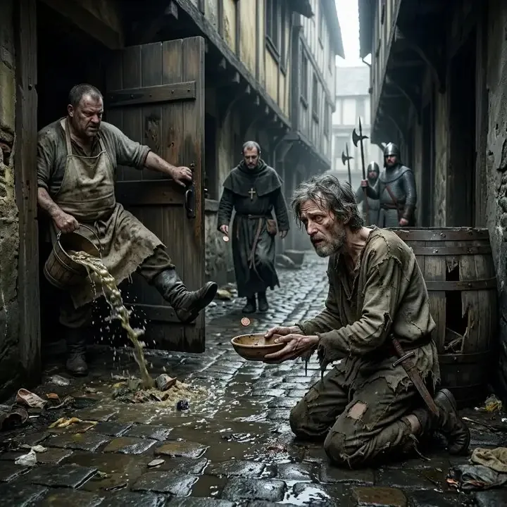

魔王死了，勇者活着回来了。

然后故事开始不对劲。

有一类西幻作品专门写这一段：秩序阵营在魔王被消灭之后，回过头来清算勇者。以前我读到这类情节总觉得别扭——一个能单挑魔王的人，凭什么被国王的军队逼到绝路？

常见的解释是「功高震主」。这个答案解释动机，不解释能力。国王想动他是一回事，动得了是另一回事。

直到我读到知乎上一篇把冒险者分成十二个档次的回答，才把这件事想明白。那篇回答写的是「顶级冒险者的生活会是什么样」，但它真正给出的，是一张**资产负债表**。

## 一、勇者身上，没有一样东西是别人能主张的

我的答案是：**勇者很有钱，但他的钱不在任何一本账上。**

屠龙这一趟，收入是赏金、战利品、国王的接见。这三样有一个共同点：一次性、现金结算、当场分完。分完就结束了。龙鳞卖掉，金币躺进箱子，故事到此为止。

国王的收入是另一回事：税基。土地每年长粮食，港口每天过船，人头每季交钱。它不壮观，但它**持续**，而且**可预估**——可预估的东西才能被贴现，被贴现的东西才能变成信用，变成军队，变成下一次战争的预算。

一边是一次性收入，一边是永续年金。这两样放在同一张桌上，三十年后谁赢，第一天其实就定了。

再看资产。

勇者最值钱的三样：装备、武力、名声。

装备折旧快，打一场修一次；而且只有你能穿，卖出去立刻贬值，抵押给谁谁不要。武力不可转移，也不能继承，它跟着肉身走，肉身一老、一伤、一死，资产归零。名声更麻烦——它不在你身上，在别人嘴里，别人一改口，它就没有了。

国王的三样：土地、爵位、军权。全部可登记、可抵押、可继承。

所以「资产负债表」在这里不是比喻。它记录的不是你有多强，而是**别人能对你主张什么**。

勇者那张表上，「别人能主张的」这一栏几乎是空的。

空，并不等于安全。空的意思是：没有任何一个机构会为他启动程序。他真去告状，法官只会问三句——地契呢？税册上有你吗？封号文书在哪？三样都没有，案子进不了系统。

国王也不需要打败他。国王只需要等。勇者的资产在折旧，国王的资产在复利。

这就是「迫害」在财务上的样子：**它不是一场战斗，是一次清算。**

最反直觉的一句话留在这里——那些真正活到顶层的冒险者，几乎全都主动把自己写进了那本册子。接受封号，接受封地，接受税吏每年上门。

那不是奖赏。那是把「不可主张的武力」换成「可主张的权利」。

拒绝登记的那位，才是故事结尾被清算的人。

## 二、这十二档真正的分级变量

那篇回答的每一档，都给了三样东西：一句别人对你说的话，一句关于法律的定义，一句「他们肯为你损失什么」。

我一开始以为第一句只是气氛。读到第五档才发现不是——那句话量的是**别人怎么称呼你**，而称呼本身是一条完整的阶梯：

玩意、喂、那个谁、外来的小子、先生、老兄、阁下、爵士、大人、冕下。

到最后两档，称呼反而消失了：众生只在心底低诵真名，因为「语言会碎」。

从「玩意」到「不敢直呼」，中间隔的不是钱。隔的是**你有没有一个可以被叫出来的名字**。

三列摆在一起，一件尴尬的事就出现了：称呼一路向上，损失一路向上，唯独中间那一列——法律——不是。

为什么？因为法律不量你的位置，它量你身上有没有东西可以被拿走。这一列留到下一节。

先说这套写法的来路。原文自己交代得很清楚：那七个名字——Wretched、Squalid、Poor、Modest、Comfortable、Wealthy、Aristocratic——出自 DND《玩家手册》的生活水平表。

可那张表本质是什么？是一张**每日开销表**。花多少钱、住什么地方、吃什么饭、雇不雇得起保镖。它回答的是「你有多少」，然后把人放进格子里，格子是静态的。

这篇回答干的事，是把「你有多少」换成了「别人肯为你押上什么」。

前者是账面，后者是授信。前者可以自己声明，后者只能由别人给出。

用财务的话说：这十二档量的根本不是资产，是**授信额度**。

所以我不觉得它是「又一篇 DND 设定介绍」。它换掉的不是内容，是坐标系。

## 三、法律不是正义的刻度，是可执行财产的刻度

把十二档里关于法律的那句话单独拎出来排一遍，会看到一条很整齐的线。

最底下四档，法律几乎不出现。不是豁免，是**跳过**。

「亡骸」档写的是「死人要什么法律，野狗才是你的判官」；「非人」档更狠，说《奴隶通令》都嫌他浪费羊皮纸；「乞食」档的法律是卫兵那根长戟，戟柄一横，你就得匍匐；到了「穷困」档，法律干脆退化成一个收费口——那件补丁摞补丁的链甲要在税官面前晃一晃，证明你有「自卫权」，而那证明书其实就是人头税的收据。

财务上的解释很朴素：没有可执行财产，程序就没法启动。法院不是不管穷人，是穷人根本不产生案件。

然后是「负重」档。原文把它标成 3.5–4.5，一个小数区间——这不是编号随意，是承认了一件事：**负重不是一个财富档位，是一个状态。** 任何一档的人背上按揭，都会掉进这个区间。

也正是这一档，第一次出现了杠杆。

那句「巨龙不可怕，可怕的是三十年按揭」，我读的时候笑了很久，因为它是全篇的枢纽。杠杆放大收益，同时也第一次把你变成**值得被追债的人**。在此之前，没人有动力起诉你——赢了也拿不到东西。有了那间带半截阁楼的石砖房，执行终于有了标的。

原文在这里写得极狠：欠债不还，送去边境矿场「劳务派遣偿还」；婚姻登记出问题，直接剥夺全部财产。约束力在这一档达到峰值。

再往上，曲线掉头。

「舒适」档的租金税本来是八金，交的时候只剩八个铜币——靠的不是减免，是一部《特殊人才适应办法》。法律开始为某些人制造例外。到「富裕」档，它「像丝绸，顺着指尖滑开」。

再往上三档，法律不再是约束你的东西，而是你产出的东西：自订《领内宪章》、成为「你阴影的形状」，最后「凡被光照过的地方，自动成为律法」。

这条曲线不是单调的，它是一个倒 U。

前段是「法律不屑于管你」，因为你没有标的；中段是「法律精准锁定你」，因为你有标的、却没有影响力；后段是「法律管不动你」，因为执法成本已经超过收益。最窄的那一段，住着负重的人。

所以那句话可以说了：**法律不是正义的刻度，是可执行财产的刻度。** 它量的不是你做了什么，而是你身上有多少东西可以被拿走。

这句判断我得自我限定一下：它是财务视角的读法，不是法学结论。现实里的法律有大量不依赖强制执行的规范力量——习惯、名誉、宪法审查，都不靠扣押财产生效。

但把这句话放进一个神权、行会、封建地权混在一起的设定里，它贴得有点过分。

  <figure>
    
    <figcaption>「乞食」：法律是卫兵的长戟（图源：原文作者所配插图）</figcaption>
  </figure>
  <figure>
    
    <figcaption>「穷困」：先搬货，再想拿钱（图源：原文作者所配插图）</figcaption>
  </figure>

<figure class="post-fig post-fig--small">
  
  <figcaption>「俭朴」：第一次拥有能上锁的门，和一张写着自己名字的租约（图源：原文作者所配插图）</figcaption>
</figure>

<figure class="post-fig">
  
  <figcaption>「舒适」：税吏下马、摘帽，先夸一句披风的薰香（图源：原文作者所配插图）</figcaption>
</figure>

## 四、十二档的财务读数

把每一档放到三个维度上读：收入是什么性质、法律对你是什么、别人愿意为你损失什么。

后两列都是原文自己给出的。第三列它每一档都写了一句关于法律的定义，从「死人要什么法律」一路写到「凡被光照过的地方，自动成为律法」——那不是炫技，是一条完整的递进链。

第四列原文写得很轻，藏在每段末尾一句「他们肯损失的……」。这是整套设定里最锋利的一把尺子，因为它量的不是你有多少，而是**别人愿意为你抵押什么**。

| 档位 | 收入的性质 | 法律对你是什么 | 别人愿为你损失什么 |
| --- | --- | --- | --- |
| 0 亡骸 | 无收入，埋葬要倒贴两个铜币 | 不存在，野狗才是判官 | 靴底沾的泥 |
| 0.5 非人 | 口粮配给，不计价 | 鞭梢的呼啸 | 挥鞭消耗的体力 |
| 1 乞食 | 施舍，不可预期 | 戟柄一横，你得匍匐 | 口袋里最轻的叮当声 |
| 2 流浪 | 日结零工，折树枝当借条 | 宵禁法，栓你一夜 | 一篮秋梨的人情 |
| 3 穷困 | 计时工资，被抽成 | 人头税收据即「自卫权」 | 三枚铜币的赌注 |
| 4 俭朴 | 委托金 + 邻里互保 | 磨刀石，得自己磨亮刀剑 | 一瓶矮人烈酒 |
| 3.5–4.5 负重 | 委托金 − 按揭本息 | 正眼盯死你，欠债即送矿场 | 一赔三，押你断供 |
| 5 舒适 | 租金 + 特权减免 | 露出甜蜜的笑 | 一整箱香料的利润 |
| 6 富裕 | 商路红利 + 信息租金 | 像丝绸，顺着指尖滑开 | 一条商路的红利 |
| 7 奢华 | 封地赋税 + 立法权 | 想抠就抠 | 国库、家族、血脉 |
| 8 传奇 | 列国供奉，主动输送 | 你阴影的形状 | 百万生灵 |
| 9 神选 | 信仰本身，不计价 | 光照过处，自动成为律法 | 整个世界 |

这张表读完，两件事浮上来。

**第一，第三列不单调。** 三档的穷人手里有「自卫权」，3.5 档有房产的人反而被法律精准锁定。约束的强弱不跟着财富走，跟着「有没有东西可以被拿走」走。

**第二，第四列严格单调。** 从「靴底沾的泥」到「整个世界」，一路只增不减，一次都没有回头。财富、武力、地位在这十二档里都反复过，只有这一列没有。

所以阶级在这套设定里不是形容词，是一个**可被第三方观测的量**：看别人肯为你押上什么。

这大概是它比「他家财万贯」高级的地方——「富有」没法被验证，而「有人肯为你输掉一条商路」可以。

## 五、它做对了什么

它没有创造新的世界，也没有创造新的职业体系。它换掉的是描述阶层的那套坐标系。

这跟我写[屠龙分账那篇](/blog/accounting-dragon-form-creator/)时的判断是同一件事：真正的形式创新换的不是内容，是骨架。

三件套是可以复用的：一句称呼（位置）、一句法律定义（约束）、一句损失刻度（授信）。换一个世界，这三列还在，因为你规定的是「看阶层的三个方向」，而不是具体内容。这一点比任何一段华丽的场景描写都更接近手艺。

它也没有回避粗糙的地方。第六到第九档，「别人愿为你损失什么」这一列开始脱离可计量——从「一条商路的红利」跳到「百万生灵」，最后是「整个世界」。刻度在这里失效了。

这不是缺陷，是这类设定的边界。写到「神选」那一档，账本就合不上了——因为它描述的不再是经济关系，是信仰关系。财务模型能解释到「传奇」，再往上得换一套语言。

顺便说一句它与 AI 的关系。AI 能给我一百张每日开销表，因为生活水平表是一种典型形式，它手里有的是。但它给不出「别人愿意为你损失什么」这条刻度——不是因为算不出来，是因为那条刻度来自一个先出现在人脑子里的问题：**阶级的刻度，应该长在谁的眼睛里？**

这也是我愿意花三千字去算一个虚构人物的账的原因。不是因为我喜欢算账。

是因为换一套记账方式，就能换一个故事被看见的方式。

---

**出处与说明**

- 原文：知乎问题「在比较正统的西幻作品中，顶级冒险者的生活会是什么样的？」下，答主「德罗萨人鱼」的回答（264 赞同），[原链接](https://www.zhihu.com/question/1932940871722047042/answer/1944080196924846226)。
- 本文所引设定文本与配图均经原作者授权；正文只作短引与转述，不整段转载，完整原文请见上方链接。
- 文中「十二档」的档位名称、台词与「他们肯损失的……」那句刻度，均属原作者；「资产负债表」「可执行财产的刻度」这套读法是我的。
- 原文中带性暗示的两处描写（第六档、第七档各一处）未引用，本文也未采用。
