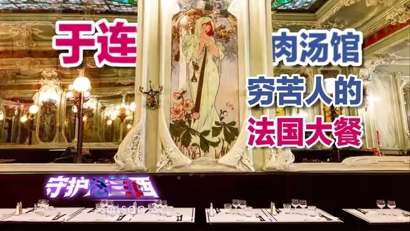
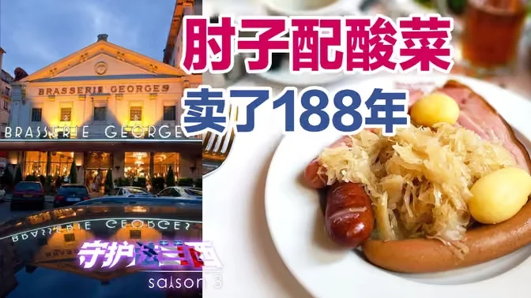

每次米其林指南在中国发榜，都会吵一轮。

吵的内容年年差不多：某某老字号在大众点评上分数平平，却能拿星；而口碑极好的街边小店，永远进不了那本红色小册子。结论也很统一——米其林不懂中餐。

我以前也这么想。直到我看了几部讲法国美食的纪录片，才意识到问题可能不在「懂不懂」，而在我们对「吃一顿饭」这件事的默认设定。

## 一、先说一件很多人不知道的事：星级标准里写的是「旅程」

我们骂米其林，通常默认它在评「好不好吃」。但它真正的判据，比这复杂，也比这狡猾。

1936 年，米其林公布了星级的具体定义，一直用到今天基本没改：

- 一星：同类别中很不错的餐厅（a very good restaurant in its category）
- 二星：出色的烹饪，值得绕道前往（excellent cooking, worth a detour）
- 三星：卓越的烹饪，**值得专程前往**（exceptional cuisine, worth a special journey）

注意三星那句话的主语。它不是在说「这盘菜有多好」，它在说「这趟路值不值得走」。

**「值得专程前往」是一个关于旅行的判断，不是关于味道的判断。**

而一盘菜，无论多好吃，都没办法单独解释一次旅行。

这里还有一层更有意思的反差。米其林官方反复强调，评星只有五条标准，全部关于食物：食材质量、技法掌握、风味协调、厨师个人风格在菜里的体现、以及每次到访的一致性。它甚至明确说过，**装潢、风格、服务都不是评星因素**——星可以从街边摊给到宫殿。

那你就要问：既然只评菜，为什么三星餐厅几乎无一例外，都是那种一顿饭吃两个半小时、一道一道上、侍者在旁边讲这道菜出自哪个村子、哪片坡地的地方？

答案是：**那套东西不写在标准里，但它是「值得专程」这四个字得以成立的物理条件。**

米其林没有把体验写进规则，但它给出的判据，逼着餐厅必须把体验做出来。

## 二、卖轮胎的，凭什么教你吃饭

这件事的起点非常不浪漫：一家轮胎公司，想让你的轮胎磨得快一点。

1900 年，米其林兄弟印发了一本红色小册子，免费送。当时全法国注册的汽车不到三千辆——车太少，轮胎就卖不动。所以他们要解决的问题不是「怎么造更好的轮胎」，而是「怎么让有车的人多开出门」。

那本小册子里有什么？地图、怎么换轮胎的说明、哪里有加油站、哪里有修车铺、哪里能住一晚、哪里能吃饭。

**它是一百年前的「高德地图 + 大众点评 + 途虎养车」。**

免费发了二十年。1920 年，安德烈·米其林去一家轮胎店，看见自己心爱的指南被店主垫在工作台腿底下。他的反应是一句很商人、也很哲学的话：人只真正尊重他付过钱的东西。于是新版开始卖钱，七法郎一本。

再往后的事情，变成了这本小册子的第二个身份。

1944 年，盟军准备诺曼底登陆。法国城镇的路标被德军拆得七七八八，参谋部手上的地图又不够细。一位早年到英国的法国抵抗组织成员 Gustave Moutet 提出：把 1939 年版的米其林指南影印出来。美军情报部门真的印了，封面从标志性的红色换成沙色（红色太显眼），印上「仅供官方使用」，发到参加登陆的各级指挥官手里。

一本美食指南，成了军事装备。

你看出这条线索了吗？**米其林从头到尾卖的都是同一件东西：上路的理由。** 先是地图和加油站，后来是餐厅和旅馆，最后是星星。轮胎只是这件事的副产品。

## 三、吃饭的本质，是一场「无条件投降」

搞懂这层，再看那顿两个半小时的饭，你会发现它是有结构的。

一道一道上，每一道都在刚好的火候上被端到你面前。菜的分量算过——让你吃两小时而不觉胀。上菜的顺序也算过：先是挑起胃口，再舒缓，再满足，最后留一点留恋。侍者会在恰当的时候说一句这道菜的来历，不多不少。

这些细节加起来，做的是同一件事：**把你的注意力从别处收回来，按到这张桌子上。**

但这套设计里最狠的一环，不在餐厅，在食客。

**你必须无条件投降。**

这两个小时里，你不能对侍者说「我想吃辣的，给我做点辣的」；你不能说「我好饿，先给我来碗能饱的」。你必须把点菜权交出去，把自己完全交付给厨师的设计。

只有彻底投降，你才可能吃到「我」以外的东西。

这一条对中餐读者是陌生的。我们的餐桌逻辑几乎相反：点菜是主人的面子，加菜是热情的表达，口味可以商量，辣度可以调整——**整张桌子都在围绕「你想要什么」运转。**

这不是高低之分，是两套完全不同的东西：一套在问「你今天想吃什么」，另一套在问「你能不能被带到某个你没去过的地方」。

## 四、真正击中我的，不是那些菜

说回纪录片。这几期片子出自 B 站 UP 主「守护法兰西」，我陆陆续续看了他家一整季。

那几部片子没有花大力气渲染食材多贵、技法多炫。它拍的是些很慢的东西：主厨清晨去集市，蹲下来挑那些还带着露水的蔬菜；后厨里为了一锅高汤，有人守了十几个小时，只是看着火。

还有一个细节我印象很深：那位 UP 主是自己配音的，明确拒绝用 AI 配音，理由是——机器念出来的东西，没有呼吸，也没有犹豫。

我当时笑了很久。一个中文 UP 主，在讲法国人怎么认真对待一顿饭；而他自己认真对待这件事的方式，是不肯让机器替他开口。

**两层「认真」叠在同一个画面里，我忽然有点难受。**

不是被馋到了，也不是被高级感震住了。是我意识到：我看这部片子的时候，桌上大概率还放着半碗已经坨了的面，手机在另一只手里。

我们不是不认真。中国人对吃的认真，是全世界少有的——刀工、火候、吊汤、发面，任何一项都能耗掉一个人半辈子。但那份认真，几乎全部投在了**「把这道菜做好」**这一件事上。

投在「这顿饭该怎么被经历」上的注意力，少得可怜。

法国人拍的其实不是美食，是**有人愿意为一件不能被加速的事，花掉十几个小时**。那不是仪式感，那是不肯加速。

而我们最擅长的，恰好是加速。

## 五、形式不是贵的东西的专利

写到这里我卡了一下。

因为上面这一整套——两个半小时、侍者讲产地、星星、专程前往——很容易被一句话挡回来：**那是富人玩的游戏，跟普通人吃一顿饭有什么关系？**

我原本也这么防备。直到同一个 UP 主又发了几期，拍的全是便宜馆子。

<figure class="post-fig">
  
  <figcaption>于连肉汤馆：一碗汤的价钱，坐进一间被列为历史古迹的厅（图源：B站 UP 主「守护法兰西」，原片链接见文末）</figcaption>
</figure>

第一家，巴黎的肉汤馆（Bouillon Julien）。它的起点跟我们的厂矿食堂是一回事：十九世纪，巴黎工人得在寸土寸金的城里吃一顿又热、又饱、又不贵的饭，bouillon 就是为这个需求开的——一碗汤，几样家常菜，坐下就吃，吃完就走。

挂到今天的招牌还是那句话：**这里的一切，都美、都好吃、都不贵。**

但你看它把钱花在哪了。

现在这间厅，是二十世纪初一位建筑师兼业主请人做的：彩绘玻璃天花板，墙上四季女神的玻璃嵌板（直接照着慕夏的画来的）、孔雀、桃心木吧台、满地天竺葵和雏菊的瓷砖。1997 年，整间餐厅被法国列为历史古迹——不是因为菜，是因为这个空间本身。

**一个工人食堂，装修成了历史古迹。**

它没有把「体面」当成奖励，而是当成基础设施：不管你花多少钱进来，坐下时面对的是一样的镜子、一样的灯、一样高的屋顶。

<figure class="post-fig">
  
  <figcaption>里昂乔治啤酒店：酸菜配肘子，1836 年卖到今天（图源：B站 UP 主「守护法兰西」，原片链接见文末）</figcaption>
</figure>

第二家，里昂的乔治啤酒店（Brasserie Georges），1836 年开张，招牌菜就是酸菜配肘子，卖到今天一百八十八年。

这家店有一个细节，我看到时整个人坐直了。

1836 年选址的时候，老板挑的是佩拉什那片刚填出来的沼泽地——因为那里正好压在**巴黎经里昂到马赛的驿车路线上**。也就是说，这家店从第一天起，做的就不是邻居的生意，是**赶路人的生意**：车停下，人下来，吃一顿，再上车。

而一百年后，1936 年，米其林把三星定义成——**值得专程前往**。

同一件事。中间隔了一百年，说的是同一个词：*journey*。

一个把它做成了每天几百人的流水，一个把它做成了一年几十人的仪式。**但底层是同一门手艺：让人愿意为了一顿饭，挪动自己的身体。**

所以形式不是「把东西做贵」。形式是把一段经历固定下来，让它可被重复：

- 一份不太变的菜单（酸菜和肘子卖了一百八十八年，主角没换过）
- 一个不会变的空间（壁画、镜子、刻着名字的椅背）
- 一套固定的节奏（坐下就知道接下来会发生什么）
- 一套固定的手势（白围裙、桶风琴推着蛋糕进场）

这四样，成本都不高。贵的是**一直不改**。

这一条对中餐其实更不客气。

我们说「中餐评不上米其林」时，潜台词常常是「那是富人的游戏，跟我们没关系」。可肉汤馆证明：一碗汤也能有形式，而且它服务的就是穷人。缺的从来不是钱。

中餐的街边店，本来也有过形式：老字号的门脸、跑堂的吆喝、先凉后热的顺序、八仙桌和长条凳。只是这些东西很少被当成资产守住——翻新一次抹掉一层，换一任老板再抹一层。抹到最后，剩下的只有味道。

这跟我写[诸圣日那篇](/blog/all-saints-day-vs-halloween/)时的判断是同一条：一个节日赢不赢，不看它有多深，看它有多容易被重复。

一家店也一样。

**形式可以很便宜。但它需要有人守。**

## 六、中餐不缺手艺，缺的是一次重新排序

带着这个念头回头看中餐，结论会变得不太舒服，但也更清楚。

中餐好不好吃？当然好吃。问题不在味道，在**这顿饭被经历的方式**。

我们太习惯把全部热情倾注在「炒好这盘菜」上：一桌菜要热、要快、要齐、要丰盛。上菜是一窝蜂摆齐的，等菜齐了才动筷，推杯换盏，杯盘狼藉。这套流程服务的是「热闹」和「丰盛」，它非常有效——但它不生产「值得专程」。

这不是说高端中餐不行。宴席有宴席的起承转合，工夫茶有工夫茶的节奏，这些我们本来就有。问题是：**这些节奏很少被当成设计对象来对待，它们只是习惯的残留。**

于是出现一个很荒谬的局面：论技法，很多中餐师傅远超米其林二星的主厨；论体验结构，很多店还停在上一个时代。

我在[《屠龙之后，那具尸体怎么分》](/blog/accounting-dragon-form-creator/)里说过一句类似的话：真正稀缺的不是把内容做得更好，而是给内容换一个骨架。放在这里就是——

**把红烧肉做得更软糯，是内容；决定这盘红烧肉在什么灯光下、第几道上、由谁端上来、配一句什么话，是形式。**

前者已经卷到极限了，后者几乎没有人做。

而这件事在 AI 时代会变得更尖锐：AI 能一秒钟给你一百个菜谱，能把任何一道传统菜的技法拆到毫秒级。它做不到的，是设计出一段「让人愿意专程跑一趟、并且在这两小时里忘记手机」的时光。

因为那不是信息，那是安排。

## 结语

下次再有人吐槽米其林又贵又难吃，你可以告诉他一件事：

米其林根本不在乎你今天有没有吃饱。

它在乎的是，这两个半小时里，你有没有从日常的琐碎里被拔出来一次——用一顿饭的价钱，买一段不属于日常的时间。

这才是商业的最高境界：**卖的从来不是产品，是你在那个产品里度过的时光。**

而我们还有很多顿饭，是可以重新设计的。

---

## 参考

**视频素材（本文图片出处）**

- [《于连肉汤馆：穷苦人的法国大餐》— B站 UP 主「守护法兰西」](https://www.bilibili.com/video/BV1r1421C7eg/)
- [《肘子配酸菜 卖了 188 年》— B站 UP 主「守护法兰西」](https://www.bilibili.com/video/BV15J4m137FS/)

**事实与史料**

- [History of the MICHELIN Guide — MICHELIN Guide 官方](https://guide.michelin.com/th/en/history-of-the-michelin-guide-th)
- [How a MICHELIN Guide Helped the Allies at D-Day — MICHELIN Guide](https://guide.michelin.com/en/article/news-and-views/how-a-michelin-guide-helped-the-allies-at-d-day)
- [What does it take to get a Michelin star? — Irish Examiner](https://irishexaminer.com/food/arid-41788556.html)
- [Media Day 2025: the MICHELIN Guide, a legend reinventing itself — Michelin](https://www.michelin.com/en/publications/products-and-services/media-day-2025)
- [Bouillon Julien — 维基百科（1901–1902 年建，1903 年开业，1997 年列为历史古迹）](https://en.wikipedia.org/wiki/Bouillon_Julien)
- [Bouillon Julien 官方站点（「Ici, tout est beau, bon, pas cher」）](https://www.bouillon-julien.com/)
- [Brasserie Georges 官方年表（1836 年 Georges Hoffherr 开业、1924 年装饰、1986 年世界最大酸菜）](https://www.brasseriegeorges.com/en/la-georges-en/)
- [第一条可拆卸充气轮胎（1891，17 颗螺钉、15 分钟换胎）— 轮胎世界网](http://www.tireworld.com.cn/community/baike/2015519/16709.html)
- [《米其林指南上海》2018 发布前复习的 25 个知识（含诺曼底登陆重印细节）— 界面新闻](https://www.jiemian.com/article/1633882.html)
