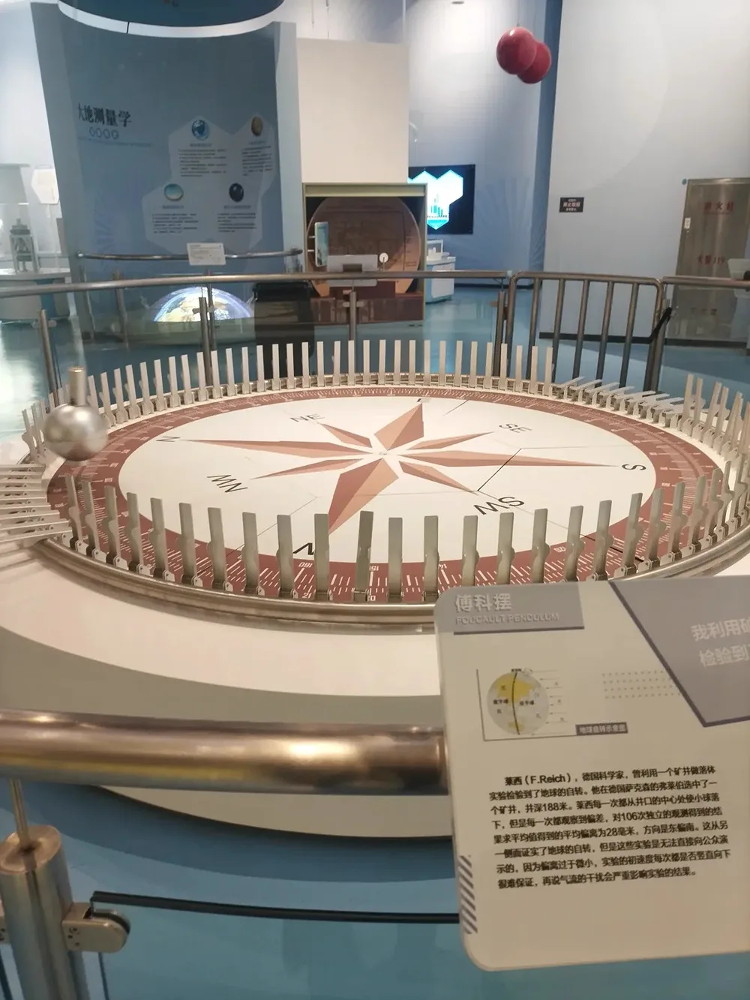
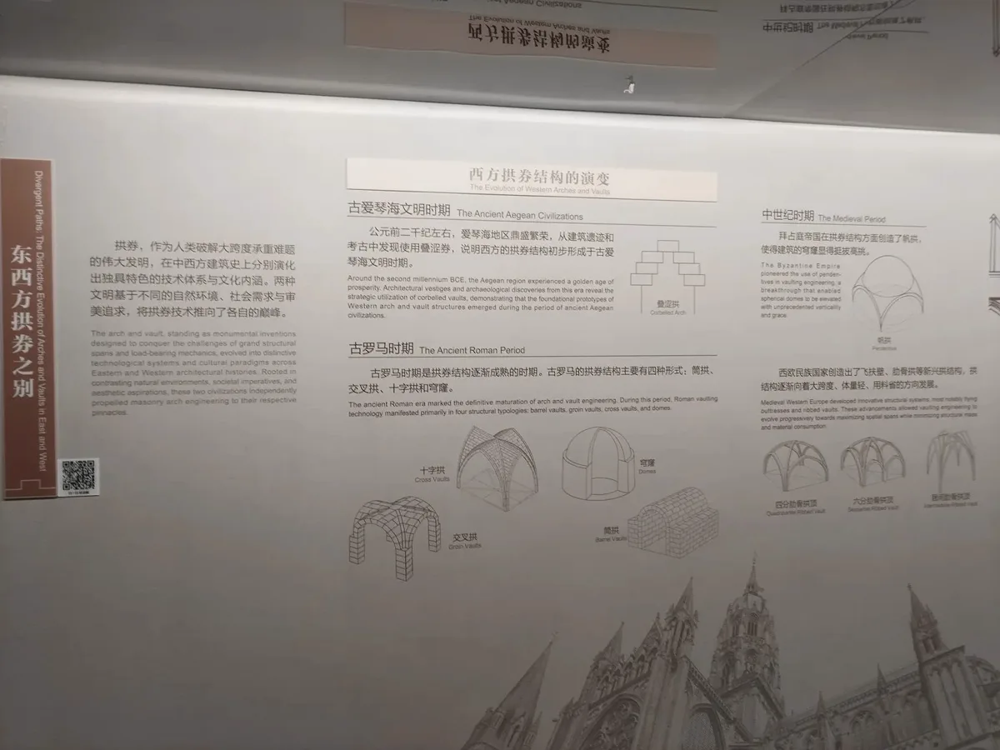
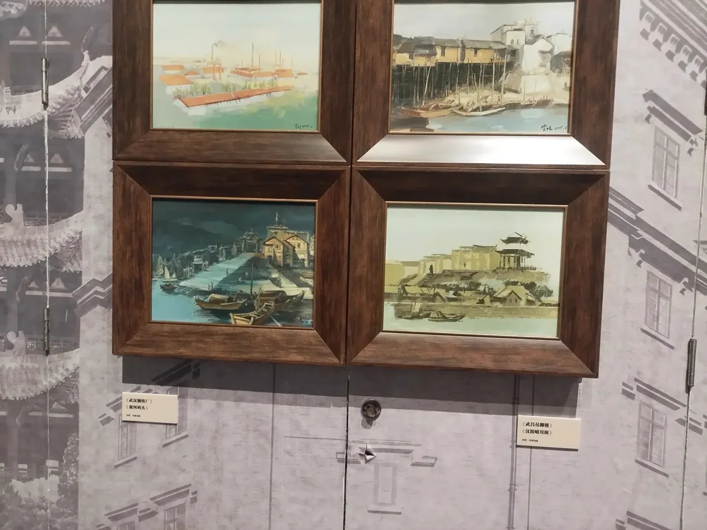

周末去了一趟本地的科技馆。

航空航天模型前面挤着中学生，互动装置前排着队。我站在后面看了一会儿，心里冒出一种很熟悉的感动：这些孩子眼里有光啊，那种光是「原来世界是这样运转的」的表情。

然后我多站了十分钟。

那十分钟里，我看到的真实情况是：大部分孩子在找哪个角落人少、哪个展项不用排队、哪张长椅可以坐下来玩手机。真正盯着展品看的，两三个。

我这才意识到，刚才那份感动不是他们的，是我的。

青春和青春的感受不能同时拥有。你身在其中时不知道那是什么，等你看得出来了，你已经不在里面了。所以我看到的「光」，其实是我把自己丢掉的东西，补到了别人脸上。

这件事跟这篇要讲的东西有关。因为接下来我在这个馆里遇到的每一件展品，都在问同一个问题：**你看到的是它本来的样子，还是被摆成的这个样子？**

## 一、牌位与香火

走廊尽头有一面墙，叫「院士风采」。

几百张证件照，统一西装、统一背景、统一打光，一格一格排下来，像某种精密的瓷砖。顶上四个大字打着背光。

有几块是空的，纯白，在白墙里反而最扎眼。

<figure class="post-fig">
  
  <figcaption>「院士风采」：统一西装、统一背景、统一打光，中间几块留白</figcaption>
</figure>

我站在那儿，脑子里冒出一句很毒的话：

> 五帝三皇神圣事，骗了无涯过客。

毛泽东 1964 年读史读出来的句子，出自《贺新郎·读史》。他骂的是旧史书：一部二十四史写满帝王将相，种田的人一个字没有，读的人还读得热泪盈眶。

挪到这面墙上，有点狠，但不算冤枉。一面墙如果把「谁值得被记住」标准化成几百个格子，它干的就是史书干的事——立传，同时替你决定不立谁。

先把话说明白：院士是实实在在做出了东西的人。问题不在他们，在这面墙。

墙的功能从来不只是纪念。纪念是「我们记得你」，而这面墙做的是另一件事：**排序**，然后**供奉**。

牌位这东西，从来都是两件套——牌位本身，和它前面那炉香。香是活人烧的。一个中学生站在这里仰头看，看的那一刻他学到的不是科学，是等级；他心里升起的那点敬畏，就是这面墙要的香火。

那几块空白，是整面墙最耐看的地方。

我一开始以为它们只是「还没评上」。可如果这面墙曾经挂满过呢？如果某一块本来有名字，后来被取下来了呢？

谁会从这面墙上被取下来？取下来之后，那块白墙算不算一种判决？

这个馆没有给我答案。但问题一被问出来，这面墙的性质就变了：它不只是一块光荣榜，它还是一套**可以撤销的名单**。能挂上去，就意味着能被拿下来。

一个孩子站在这里，会同时收到两条信息：科学很神圣；神圣的位置只有这么多，而且不归你管。

这两条信息，会陪他很久。

## 二、铁球：它也是展品

出了那条走廊，是科技馆的大厅。

铁球从很高的穹顶垂下来，在一圈罗盘图案上摆，摆幅所及，边缘的木桩被一根根撞倒。没有解说，没有灯光秀，只有铁球和木头的声音。

<figure class="post-fig">
  
  <figcaption>铁球、罗盘与一圈木桩：撞倒木桩的间距是算过的，为的是让偏转在几分钟内可见</figcaption>
</figure>

它在证明地球自转。

我原本想在这里写一句漂亮话：这是整个馆里唯一的诚实者。

但我站了一会儿，发现自己错了。**它也是展品。**

它被选中、被布置、被打上灯、被写进展板，连「撞倒木桩」这个效果都是设计过的——木桩的间距算好了，让你在几分钟里就能看见偏转。它和院士墙、和后面那些展板一样，都是被摆出来的。

所以它值得信任的地方不在「存在」，在**机制**。

馆可以决定它挂在哪里，但馆不能决定它摆向哪边。这就是区别：院士墙的名单由人写入，铁球的轨迹不由人写入。前者靠背书，后者靠复现。

你不用信傅科，不用信教科书，不用信墙上任何一张脸。你站这儿看一分钟，自己就能看出摆面在转；你换个城市再做一遍，转的速度会变，规律不变。

展牌上还有个比傅科更早的例子：德国科学家莱西（F. Reich）1831 年在矿井里往下扔球，竖井深 188 米，扔了 106 次，平均向东偏 28 毫米。

傅科摆问世之前二十年，已经有人用 106 次重复，把同一件事钉死了。

这种可复现在今天反而是稀缺品。2015 年，270 位研究者组队重做 100 项发表在心理学顶刊上的实验，能复现出显著结果的只有 36%；2021 年同一批人查癌症生物学，193 个实验里只有 50 个做得出来，效应量平均缩水 85%。这就是所谓「可重复性危机」。

我提这个不是要唱衰科学。恰恰相反：科学之所以配得上信任，不是因为它从不犯错，是因为它造了一套专门抓自己错的机制，而且愿意把抓到的错登在封面上。

院士墙抓不到自己的错。它只会把格子填满。

## 三、拱券：被重力纠正的历史

从科技馆出来，隔壁是中国建筑馆。

科技馆里人声鼎沸，这里门可罗雀。墙上一条长展板，标题是「东西方拱券之别」。我一格一格看过去，看到了一件比院士墙更微妙的事。

先说什么叫「建筑是凝固的音乐」。

这句话常被当成修辞，其实很实：音乐在**时间**里安排节奏，建筑在**空间**里安排节奏。人耳对节拍极其敏感，这是几百万年演化出来的能力；而把同一套节奏感翻译到空间轴上——看出一排柱子的间距、一段拱廊的明暗、宏大与细部之间的张力——那是另一种能力，得练。

能听出节奏的人多，能看出节奏的人少。所以建筑比音乐更容易被当成「样式」来消费。

拱券就是空间里的节拍器。

原理很朴素：把重力沿曲线导到地面。所以拱比梁跨得远、比梁薄。但拱真正厉害的地方不在结构，在身体——人穿过一道拱门，会不自觉地放慢脚步、抬头看。

那是仪式感的物理来源：你的身体先知道「这里不一样」，然后脑子才去找理由。

一节接一节的连续拱廊，就是这台节拍器的连续演奏：明暗交替，柱影移动。节奏要稳，宽高比得控制在一比一到二点五比一之间——太扁压抑，太尖就像教堂；柱距也要和柱宽对上，否则节拍就乱。

看西方那半边：叠涩拱、筒拱、交叉拱、十字拱、穹窿、肋拱、尖券、飞扶壁。

<figure class="post-fig">
  
  <figcaption>「西方拱券结构的演变」：从叠涩拱到飞扶壁，每一格都是一次被迫的修正</figcaption>
</figure>

我原本想在这里写一句狠话：这是一部塌方史。写到这儿改主意了——「塌方」这词带贬义，而建筑史不是耻辱柱。

维特鲁威在《建筑十书》里给建筑定了三件事：坚固、适用、美观。这三条不是并列的，是有先后的：不坚固，谈不到适用；不适用，美观就只是装饰。而展板上那一串演变，每一次都是因为前一条没达标，被迫往回收。

筒拱取代叠涩拱，是因为叠涩跨不了大空间。十字拱取代筒拱，是因为筒拱把推力全压在两侧墙上，墙要厚到荒唐。飞扶壁出现，是因为高墙要倒，得从外面扶一把。

所以这不是失败清单，是一部**被重力反复纠正、然后往前走的历史**。它跟科学是同一种进步方式：出错的不是人，是上一版的认知；塌一次，改一次，认知往前挪一格，下一版就站在这一版上。

只是这些格子没有署名。

那些塌掉的教堂，绝大多数不知道设计者是谁。中世纪的工匠不留名，行会记的是做法，不记人名。今天我们在展板上看到的是「罗马式」「哥特式」——风格有名字，人没有。

这一点跟院士墙正好相反：墙只记得住成功者，而拱券的每往前一步，都站在一群无名者的废墟上。那些人不寂寞，因为他们的做法还活着；寂寞的是他们的名字。

## 四、编木桥：两种记谱法

东方那半边是编木拱桥。《清明上河图》里那座虹桥，用短木纵横交错，像织布一样「编」出一跨。不用一根钉子，因为钉子是刚性的，木头会缩会胀会震，钉子一锈，桥就从内部开始烂。闽浙一带的廊桥至今还在用这套做法，三节苗、五节苗互相编织，一根断了，力会绕过去。

这不是「不懂力学的直觉」。《营造法式》里那套材分制，把构件尺寸做成等级表，什么等级的殿用几等材，写得清清楚楚。

再往深一层，这两种乐谱背后是两种文明底色。

西方的理念主义有两个源头：希腊的几何，和基督教的律法。几何说世界可以被算式描述；律法说规则先于个案存在——十诫不是从案例里总结出来的，是先给定、再执行。两者合流，就有了「先有图纸，后有建筑」的传统：图纸是理念，房子是理念的复制品；房子塌了，说明复制出了错，不说明理念有错。

中国的经验主义也有两个源头：广袤国土上的复杂问题，和一部太长的历史。这片土地的气候、水系、材料、工匠流派差异极大，一套抽象规则覆盖不过来；而历代留下的旧例、做法、匠书，反而是最可靠的答案来源。《营造法式》本身就是把前人怎么做整理成册——它不太推导，它归档。

所以那句「凝固的音乐」，西方听的是作曲，中国听的是唱腔。一个有谱，一个有调。

到这儿，违和感的来源就清楚了。

不是把东方和西方摆在一起违和。违和在于：这个馆把两种乐谱都**降格成了壁纸**。

拱券变成纹样，榫卯变成造型，「东方味」变成一个可以贴在墙上的标签。力学抽走了，制度抽走了，剩下的只有好看。

这就是表皮和骨肉的撕裂：骨肉是「为什么会塌、为什么不塌」，表皮是「这个造型很有味道」。

旁边还挂着四幅水彩，画的是武汉的老码头与旧城，装进深色木框，打上射灯。它们被装进了同一个逻辑——一座城市的历史，最后变成几张可以挂在墙上的图。

<figure class="post-fig">
  
  <figcaption>武汉老建筑的水彩，装进木框、打上射灯——和拱券、榫卯一起，被归入「样式」</figcaption>
</figure>

## 五、结语：君子不器，这里得借用一下

走出建筑馆的时候，我又想起科技馆大厅里那颗铁球。

铁球和编木桥像的地方，不是「都靠经验」。它们像在另一处：**都允许误差，所以都能被重复。**

榫卯允许位移，所以地震时晃而不散；铁球允许偏差，所以 106 次的平均数才是证据。一个靠容错活下来，一个靠容错被证明。

《论语》里那句「君子不器」，原意是君子不该像器具那样只具备一种用途——是说人要有通达之德，不是「不要当工具人」。我这里借它的反面来用，先交代清楚。

器是定型的东西。定了型，就只有一个用处，也只有一个位置。

一面墙把活人做成牌位，一套展陈把知识做成壁纸，一条走廊把「谁值得被记住」做成格子——这才是「器」。

真正的科学精神不是造神。它不需要你对着满墙的照片行礼，也不需要你把「科学家故事」背成童话。

它是承认那些在实验室里熬到半夜的研究生也是历史的创造者；是看懂拱券的每一次演变背后都有一座塌掉的房子；是站在铁球前面，不预设任何立场，自己看一眼。

万有引力不认头衔，地球自转也不需要谁颁奖。

回程路上我想起那些中学生。他们还在找长椅。这很正常——十七岁的时候，谁会觉得一座馆里的东西比手机重要。

我只是希望，等他们有一天突然想抬头看的时候，墙上少一块牌位，多一个能被自己验证的铁球。
